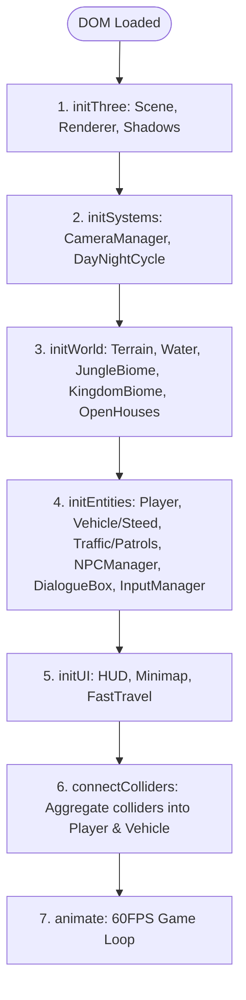

# 🏛️ Architecture & Technical Specifications

This document outlines the internal architecture, mathematical models, system lifecycles, and physics pipelines of the **Agent66 Medieval Kingdom Open World RPG**.

---

## 🔄 Core Application Lifecycle (`src/main.js`)

The `GameApp` class orchestrates the application through an explicit setup sequence:



### Every Frame (`animate()`):
1. **Input Processing**: `inputManager.update()` polls keys, click-to-move vectors, interact key `[E]`, map key `[M]`, and camera keys `[1, 2, 3, V]`.
2. **Entity Physics**:
   - If mounted on steed: `vehicle.update(delta, inputManager)`, player position tracks vehicle.
   - If on foot: `player.update(delta, inputManager)`, `vehicle.update(delta, inputManager)`.
3. **NPC Proximity**: `npcManager.update(delta, playerPos)` checks distances for `[E] Talk` prompt.
4. **Environment Updates**:
   - `traffic.update(delta)` updates marching knights and ox carts.
   - `kingdom.update(delta)` rotates windmill sails.
   - `water.update(elapsedTime)` perturbs water vertices for waves.
   - `jungle.update(elapsedTime)` animates sunstone relic and fireflies.
5. **Open House Roof Lerp**: `openHouses.update(delta, activePos)` tests interior bounds, animates roof cutaways, and triggers HUD toasts.
6. **Atmosphere**: `dayNightCycle.update(delta, activePos)` advances sun/moon positions and updates dynamic lights.
7. **Camera Follow**: `cameraManager.update(delta, activePos)` smoothly interpolates the active camera position.
8. **Minimap**: `minimap.drawMinimap(activePos, rot, openHouses)` redraws 2D canvas radar.
9. **Render**: `renderer.render(scene, camera)`.

---

## 📐 Camera System (`src/systems/CameraManager.js`)

The camera manager supports three distinct perspectives:

```
                  +-----------------------------------+
                  |          CameraManager            |
                  +-----------------------------------+
                     |              |              |
                     v              v              v
               ISOMETRIC (2.5D)   TOP-DOWN (2D)  PERSPECTIVE (3D)
               OrthographicCamera OrthographicCamera PerspectiveCamera
               Rotated 45°, Elev 35° Pure (0, 1, 0)      Chase Camera
```

- **Isometric Mode (2.5D)**:
  - Orthographic projection eliminates perspective distortion, giving the classic stylized diorama look.
  - Position offset: `(target.x + 40, target.y + 40, target.z + 40)`, looking at `(target.x, target.y + 1, target.z)`.
- **Top-Down Mode (2D)**:
  - Pure overhead view looking straight down along the Y-axis.
  - Ideal for retro 2D open-world map navigation.
- **Perspective Mode (3D)**:
  - 60° FOV perspective camera positioned at `target.y + 7`, distance `14m` behind the player.
- **Smooth Zoom**:
  - Scales orthographic frustum bounds (`zoomFactor` clamped between `0.4` and `2.5`).

---

## 🛡️ Collision Engine & Sub-Stepping (`src/utils/collision.js`)

To prevent tunneling through thin walls, fences, and stall counters when running or riding at high speeds, collision detection is decoupled from frame delta into **sub-stepped micro-increments**:

$$\text{stepLength} = \|\Delta\vec{p}\|, \quad \text{subSteps} = \max\left(1, \left\lceil \frac{\text{stepLength}}{\text{MAX\_SUBSTEP}} \right\rceil\right) \quad (\text{where } \text{MAX\_SUBSTEP} = 0.10\text{m})$$

### Collider Types
1. **Axis-Aligned Bounding Box (AABB)**:
   ```javascript
   { type: 'box', minX: 10, maxX: 26, minZ: -140, maxZ: -126 }
   ```
   Depenetration finds the closest point on the box perimeter and pushes the player circle (`radius = 0.65m`) outward along the minimum penetration axis.

2. **Cylindrical Column / Tower Collider**:
   ```javascript
   { type: 'cylinder', x: 200, z: -150, radius: 4.5 }
   ```
   Depenetration calculates 2D Euclidean distance $d = \sqrt{(x - x_c)^2 + (z - z_c)^2}$. If $d < r_{\text{player}} + r_c$, position is pushed outward along normal $\frac{\vec{p} - \vec{c}}{d}$.

---

## 🏠 Open Houses & Cutaway Roof System (`src/world/OpenHouses.js`)

Each enterable house is defined by:
- **`bounds`**: 2D AABB bounding box covering the interior.
- **`roofMesh`**: The Three.js mesh/group representing the roof.
- **`roofInitialY`**: The resting height of the roof.

### Cutaway Lerp Math:
When player enters the bounds:
$$\text{targetY} = \text{roofInitialY} + 8.0\text{m}, \quad \text{targetOpacity} = 0.0$$
When player exits:
$$\text{targetY} = \text{roofInitialY}, \quad \text{targetOpacity} = 1.0$$

At every frame:
$$\text{currentY} \leftarrow \text{lerp}(\text{currentY}, \text{targetY}, \Delta t \times 6.0)$$
$$\text{currentOpacity} \leftarrow \text{lerp}(\text{currentOpacity}, \text{targetOpacity}, \Delta t \times 6.0)$$

This produces a silky-smooth architectural dollhouse effect.

---

## ☀️ Dynamic Day/Night Cycle (`src/systems/DayNightCycle.js`)

- Complete 24-hour cycle simulates sunlight progression:
  - **Sun Angle**: Orbit in a 3D circle around the world origin ($X = \cos(\theta) \times 300, Y = \sin(\theta) \times 300$).
  - **Dynamic Shadows**: Shadow camera frustum tracks the player's active position to maintain maximum shadow map resolution near the player.
  - **Night Lighting Registration**: All torches, braziers, and lanterns register their Three.js lights with `dayNightCycle.registerNightLight(light)`. At dusk, light intensities smoothly scale from `0.0` to their `baseIntensity`.
  - **Firefly Particles**: In the jungle, glowing green/yellow firefly particles oscillate vertically using sinusoidal offsets when night falls.

---

## 🐎 Mount System: Royal Warhorse Steed (`src/entities/Vehicle.js`)

The mount system adapts high-performance vehicle physics to an equestrian model:
- **Locomotion**: Acceleration, deceleration, natural friction drag, turning radius proportional to speed.
- **Gallop Animation**: 4 leg groups oscillate in a trotting/galloping cadence:
  $$\text{angle} = \sin(\text{animTime} \times 12) \times 0.45$$
- **Camera Mount Point**: Smoothly shifts to the steed's center when mounted.
- **Dismount Safety**: On dismount, the player is safely spawned $2.5\text{m}$ to the side with sub-stepped collision applied so they never clip into a wall or fence.

